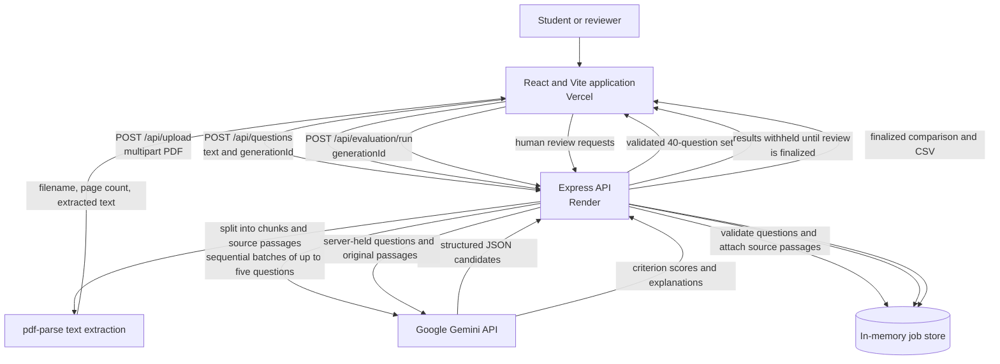

# AI Question Bank Generator

**BME AI in Practice — Homework Assignment #16**

AI Question Bank Generator turns the selectable text in a lecture PDF into a source-grounded study question bank. It also provides an AI-assisted quality review and a separate, blinded human-review workflow for comparing judgments. The project was developed for BME AI in Practice Homework Assignment #16.

## Table of contents

1. [Project overview](#1-project-overview)
2. [Live demo and repository](#2-live-demo-and-repository)
3. [Features](#3-features)
4. [Technology stack](#4-technology-stack)
5. [System architecture](#5-system-architecture)
6. [Installation and local development](#6-installation-and-local-development)
7. [Environment variables](#7-environment-variables)
8. [Deployment](#8-deployment)
9. [How to use the application](#9-how-to-use-the-application)
10. [Evaluation methodology](#10-evaluation-methodology)
11. [Development experiences and lessons learned](#11-development-experiences-and-lessons-learned)
12. [Limitations and future improvements](#12-limitations-and-future-improvements)
13. [Testing](#13-testing)
14. [Project structure](#14-project-structure)
15. [Conclusion](#15-conclusion)

## 1. Project overview

Turning lecture material into useful practice questions can be time-consuming. This application automates the first draft: a student uploads a lecture PDF, the backend extracts its selectable text, and Gemini generates questions tied to passages in that lecture. The question bank can then be reviewed by an AI quality judge and compared with a human review.

The application is intended to support study and assignment work. Generated questions and AI scores are aids for review, not authoritative assessments of learning or question quality.

## 2. Live demo and repository

| Resource | Link |
|---|---|
| Live application | [AI Question Bank Generator on Vercel](https://ai-question-bank-generator-ai-in-pa.vercel.app) |
| Source repository | [GitHub repository](https://github.com/huzaifanaseerx3/ai-question-bank-generator-ai-in-paractice) |
| Backend health check | [Render API health endpoint](https://ai-question-bank-generator-ai-in.onrender.com/api/health) |

The health endpoint returns `{"status":"ok"}` when the Express service is responding. PDF upload and text extraction do not call Gemini, but **question generation and AI evaluation require Gemini API access** configured on the backend. The browser never receives the Gemini API key.

The links were checked on 24 November 2026. The Vercel app and GitHub page returned HTTP 200; the backend health endpoint returned HTTP 200 with `{"status":"ok"}`. The live backend also returned the expected CORS header for the Vercel origin and a successful upload preflight. These checks verify availability and cross-origin headers, not a complete live question-generation run.

## 3. Features

### Lecture upload and question bank

- Upload a PDF up to 15 MB and extract selectable text, filename, and page count.
- Generate exactly **30 multiple-choice questions** and **10 short-answer questions** when the source supports a complete set.
- MCQs have four distinct options. Each question includes a correct answer and explanation.
- Each question references a numbered source passage. The server attaches the original passage text as evidence instead of relying on Gemini to reproduce a verbatim quotation.
- View questions, choices, answers, explanations, and source passages in the Question Bank page.
- If the lecture cannot support enough distinct, verifiable questions, generation reports an error instead of filling the set with unsupported questions.

### AI quality evaluation

- Evaluate the generated set against the original, server-held lecture passages.
- Score each question from 1 to 5 on answer correctness, question clarity, lecture grounding, and explanation quality.
- View per-criterion explanations and summary statistics, and export the AI evaluation as CSV.
- AI scores and decisions are labelled as AI judgments and remain hidden until human review is finalized.

### Human review and agreement

- Review a deterministic sample of **20 questions**: 15 MCQs and 5 short-answer questions, distributed across source passages.
- Submit an independent Pass or Fail decision and an optional comment for each question. Reviews can be edited before finalization.
- Finalize all 20 reviews to reveal the AI–human comparison, agreement percentage, confusion matrix, Cohen's kappa, and disagreements.
- Export the paired human and AI judgments, comments, source passage IDs, and metrics as CSV.

### Interface and service behavior

- Responsive React interface with Dashboard, Upload materials, Question bank, Evaluation, and Human review pages.
- Health status indicator for the backend connection.
- Sequential, small Gemini request batches, structured JSON validation, bounded retries, and resumable in-memory jobs for generation and evaluation.
- CORS configuration for the production Vercel origin and local development origins.

## 4. Technology stack

Versions below are those resolved in the repository's current lockfile and installed environment. `package.json` declares compatible version ranges.

| Area | Technology | Version |
|---|---|---:|
| Frontend | React / React DOM | 18.3.1 |
| Frontend routing | React Router | 6.30.6 |
| Frontend build tooling | Vite | 6.4.6 |
| React Vite plugin | `@vitejs/plugin-react` | 4.7.0 |
| Styling | Plain CSS | — |
| Backend runtime | Node.js | 20.16+ (20.x), or 22.3+ |
| Backend framework | Express | 4.22.3 |
| AI integration | Official Google GenAI JavaScript SDK (`@google/genai`) | 1.28.0 |
| Current Gemini model | `gemini-3.5-flash-lite` | Configured in backend source |
| PDF processing | `pdf-parse` | 2.4.5 |
| Upload handling | Multer | 2.5.0 |
| CORS and environment loading | `cors`, `dotenv` | 2.8.6, 16.6.1 |
| Workspace development | `concurrently` | 9.2.5 |
| Backend tests | Node.js built-in `node:test` and `assert` | — |
| Deployment | Vercel frontend, Render backend | Provider-managed |

The Node.js requirement follows the installed `pdf-parse` package engine range. The runtime used for the checks documented here was Node.js 20.19.5 with npm 11.5.1.

## 5. System architecture

The Vercel-hosted React application sends requests to the Render-hosted Express API. PDF parsing and all Gemini calls run on the backend. The frontend receives extracted text and generated results, while the backend keeps the authoritative generation, evaluation, and review job data in memory.



### API routes

All routes are served by the Express application in `backend/src/app.js`. The CORS middleware is registered before the routes and handles allowed-origin preflights.

| Method and path | Purpose |
|---|---|
| `GET /api/health` | Service health check; returns `{ "status": "ok" }`. |
| `POST /api/upload` | Accepts a multipart PDF in the `file` field; returns filename, page count, and extracted text. |
| `POST /api/questions` | Accepts `{ "text": "...", "generationId": "..." }`; returns the generated question set or safe progress/error details. |
| `POST /api/evaluation/run` | Starts or resumes evaluation using a server-held job identified by `generationId`. |
| `GET /api/evaluation/status?generationId=...` | Returns evaluation progress. Before review finalization, it withholds score summaries. |
| `GET /api/evaluation/results?generationId=...` | Returns AI results only after human review is finalized. |
| `GET /api/human-review/sample?generationId=...` | Retrieves the server-selected sample and saved human decisions, without exposing AI decisions. |
| `POST /api/human-review/review` | Saves or edits one sampled human decision and optional comment. |
| `POST /api/human-review/finalize` | Locks a complete set of 20 reviews and returns the comparison. |
| `GET /api/human-review/comparison?generationId=...` | Retrieves the comparison after finalization. |
| `GET /api/human-review/export?generationId=...` | Downloads the finalized paired comparison as CSV. |

## 6. Installation and local development

### Prerequisites

- Node.js 20.16 or later in the 20.x series, or Node.js 22.3 or later.
- npm 9 or later.
- Gemini API access for question generation and AI evaluation.

### Install

Run commands from the repository root:

```sh
npm install
```

For a clean install in CI or deployment, the repository also includes a lockfile and supports:

```sh
npm ci
```

Copy the example files for local configuration. In PowerShell:

```powershell
Copy-Item .env.example .env
Copy-Item backend/.env.example backend/.env
```

On macOS or Linux:

```sh
cp .env.example .env
cp backend/.env.example backend/.env
```

Set `GEMINI_API_KEY` in `backend/.env` to your own key. Do not put it in a frontend variable, commit it, or paste it into source code.

### Run both applications

From the project root:

```sh
npm run dev
```

This starts both workspaces using `concurrently`:

- Frontend: <http://localhost:5173>
- Backend: <http://localhost:3001>
- Health check: <http://localhost:3001/api/health>

Alternatively, run each application in a separate terminal:

```sh
npm run dev --workspace=backend
```

```sh
npm run dev --workspace=frontend
```

To run the production frontend build and start the backend:

```sh
npm run build
npm start
```

The frontend is a static Vite build in `frontend/dist`; `npm start` starts the Express server.

## 7. Environment variables

| Variable | Where it is used | Purpose |
|---|---|---|
| `GEMINI_API_KEY` | Backend only | Authenticates backend requests to Gemini. Required for question generation and AI evaluation. Never use a `VITE_` prefix for this key. |
| `FRONTEND_URL` | Backend runtime | Adds one or more comma-separated HTTP(S) frontend origins to the CORS allow-list. Trailing slashes are normalized. The current production origin and localhost development origins are also allowed by the application. |
| `PORT` | Backend runtime | Port for Express. Render provides this in deployment; the local fallback is `3001`. |
| `NODE_ENV` | Optional runtime convention | The application does not currently read this variable explicitly or change its own behavior based on it. |
| `VITE_API_URL` | Frontend build time | Public backend base URL used by all frontend API requests. Defaults to localhost in development and the Render backend in production. This is not a secret. |

Placeholder examples:

```dotenv
# backend/.env
GEMINI_API_KEY=your_gemini_api_key
FRONTEND_URL=http://localhost:5173
PORT=3001
NODE_ENV=development
```

```dotenv
# Repository-root .env, read by Vite (frontend)
VITE_API_URL=http://localhost:3001
```

The checked-in `.env.example` files contain placeholders only. The backend loads `backend/.env` and then the root `.env`; dotenv does not overwrite variables already present in the process environment. For local backend settings, prefer `backend/.env`. Vite is configured to read the repository-root environment file, and only the public `VITE_API_URL` setting is needed by the frontend.

## 8. Deployment

The live frontend is hosted on Vercel and the backend on Render. There are no checked-in `vercel.json` or `render.yaml` deployment manifests; provider project settings and secret values are managed outside the repository.

### Vercel frontend

Use the repository's root workspace build script and publish the Vite output:

| Setting | Value |
|---|---|
| Install command | `npm ci` |
| Build command | `npm run build` |
| Output directory | `frontend/dist` |
| Environment variable | `VITE_API_URL=https://ai-question-bank-generator-ai-in.onrender.com` |

`VITE_API_URL` is embedded into the frontend during the build. Redeploy the frontend after changing it. The source also has a production fallback to the same Render API URL.

### Render backend

Run the backend from the repository root:

| Setting | Value |
|---|---|
| Build command | `npm ci` |
| Start command | `npm start` |
| Environment variable | `FRONTEND_URL=https://ai-question-bank-generator-ai-in-pa.vercel.app` |
| Environment variable | `GEMINI_API_KEY=<your backend-only Gemini key>` |
| Port | Use Render's provided `PORT` value. |

The root `npm start` script invokes `npm run start --workspace=backend`, which runs `node src/server.js`. The backend accepts its production frontend origin, the two local Vite origins, and any valid HTTP(S) origins supplied in `FRONTEND_URL`. It allows `GET`, `POST`, and `OPTIONS` with the `Content-Type` header and does not enable credentialed wildcard CORS.

After deployment, verify the health route and the browser origin's CORS preflight. On 24 November 2026, the live health endpoint returned the expected CORS origin header, and the upload `OPTIONS` request returned HTTP 204 with `GET,POST,OPTIONS` and `Content-Type` allowed.

## 9. How to use the application

1. Open the [live application](https://ai-question-bank-generator-ai-in-pa.vercel.app), or start both services locally as described above.
2. Open **Upload materials**, select or drop a lecture PDF, and choose **Extract text**. The application displays the filename, page count, and extracted text.
3. Select **Generate 40 questions**. The backend sends sequential, structured requests to Gemini and validates the returned questions against their assigned lecture passages. When complete, open **Question bank** to inspect questions, options, answers, explanations, and evidence.
4. Open **Evaluation** and choose **Run AI evaluation**. The UI shows progress. If a batch fails, retrying the same generation can resume completed work while the backend job remains available.
5. After evaluation completes, open **Human review**. Review the selected questions one at a time; mark each Pass or Fail and optionally add a comment. AI decisions remain hidden during this step.
6. After all 20 reviews are saved, choose **Finalize and view comparison**. Finalization locks the human reviews and reveals agreement metrics and disagreements.
7. Export the AI evaluation CSV from the Evaluation page and the paired AI–human CSV from the finalized comparison page.

The current session is held in browser and backend memory. Avoid refreshing the page or restarting the backend during a review workflow; see [Limitations](#12-limitations-and-future-improvements).

## 10. Evaluation methodology

### AI quality evaluation

The backend sends each question with its original server-held source passage to Gemini in sequential batches of at most five. Gemini returns four integer scores from 1 to 5 with explanations:

1. **Answer correctness** — whether the marked answer is accurate and supported by the passage; for MCQs, whether the distractors create ambiguity.
2. **Question clarity** — whether the question is understandable, focused, and answerable.
3. **Lecture grounding** — whether the question and answer are grounded in the source passage.
4. **Explanation quality** — whether the author explanation is clear, relevant, and consistent with the passage.

The application—not Gemini—computes the binary result: a question **passes only when all four scores are at least 3**; otherwise, it fails. Gemini's scores and explanations are judgments, not ground truth. The implementation validates response structure, integer score ranges, and required fields, but automated checks cannot guarantee semantic correctness.

### Human sample and AI–human agreement

The backend selects a reproducible, stratified sample of 20 from the 40 generated questions: 15 MCQs and 5 short-answer questions. A SHA-256 seed is derived from the lecture text hash and a sampling-version label. Within each question type, seeded question groups are selected round-robin across source passages. Stable IDs identify the selected questions.

Human decisions are manually submitted as Pass or Fail; unanswered questions are never assigned a default value. The comparison is available only after all 20 reviews are finalized.

- **Agreement percentage** is the number of matching paired decisions divided by the number of completed pairs (20 after finalization), multiplied by 100.
- **Confusion matrix** counts each pair by the human decision (rows) and AI decision (columns). It makes agreement and disagreement types visible.
- **Cohen's kappa** adjusts observed agreement for agreement expected from the two decision distributions:

  \[
  \kappa = \frac{p_o - p_e}{1 - p_e}
  \]

  Here \(p_o\) is observed agreement and \(p_e\) is expected agreement from the human and AI marginal proportions. Kappa is reported as undefined when there are no paired decisions or when expected agreement is 100%.

The comparison describes one reviewer and one sample. It does not measure inter-reviewer reliability or establish either reviewer as ground truth. No assignment evaluation results are included in this README.

## 11. Development experiences and lessons learned

GitHub Copilot Agent Mode was used to assist with implementation, debugging, test creation, and documentation. The repository history records the initial application and subsequent frontend API/CORS fixes; project notes also record earlier investigations into Gemini service errors, partial generation, and blinded review.

The deployment troubleshooting proceeded from observable symptoms rather than assumptions:

- The frontend and backend were inspected separately to identify which requests used the configured API base URL.
- Production API requests were centralized around `VITE_API_URL`, while retaining localhost development behavior. The frontend variable is public and is embedded at build time; it must never contain a Gemini key.
- The backend CORS allow-list and preflight behavior were then inspected using the exact Vercel origin and Render routes. A health response alone was insufficient: the API could return HTTP 200 while the browser still blocked access because the response lacked `Access-Control-Allow-Origin`.
- Regression tests were added for the production origin, local development origins, rejected origins, upload preflight, and request headers. A live health/preflight check was also used after deployment to verify the response headers.

The main lesson is that frontend build-time configuration and backend runtime configuration are different: `VITE_API_URL` selects a public API endpoint in the browser bundle, while `GEMINI_API_KEY` and `FRONTEND_URL` belong on the backend. Local tests are valuable, but they do not prove that provider dashboard variables or the deployed CORS response are correct; verify the live endpoints after deployment.

## 12. Limitations and future improvements

- **In-memory data only:** generated questions, original lecture text, AI evaluations, and human reviews are stored in the backend process. Jobs expire after 30 minutes of inactivity, the cache holds at most 20 jobs, and a restart or eviction makes those sessions unavailable. Multiple backend instances do not share this state.
- **No database persistence:** SQLite is not integrated. A database and durable job/session storage would be a useful future improvement.
- **Browser state is temporary:** the current question set and generation ID live in React state; refreshing or reopening the browser loses the client-side session reference.
- **No OCR:** scanned-image PDFs without selectable text cannot be processed. Uploads are limited to 15 MB, and extracted lecture text is limited to 750,000 characters.
- **Grounding is not proof:** source IDs, structural validation, token-overlap checks, and deterministic passage excerpts help detect unsupported output but do not constitute a complete semantic fact-check.
- **AI evaluation is fallible:** scores can be mistaken or variable. They should be checked against the lecture and are not objective ground truth.
- **Single human reviewer:** the application records one reviewer's decisions for the selected sample; it does not support multiple reviewers or inter-rater reliability analysis.
- **No user authentication or application-level request rate limiting:** CORS restricts browser origins but is not an authorization mechanism. Public deployments should consider authentication, abuse controls, and Gemini quota protections before broader use.
- **Dashboard summaries are partly illustrative:** the question count is connected to current frontend state, while study-material and evaluation overview cards are not backed by persistent analytics.
- **External service dependency:** question generation and AI evaluation require network access, a valid backend Gemini key, and available provider quota.

## 13. Testing

Run from the repository root:

```sh
npm test --workspace=backend
npm run build
```

The backend suite uses Node's built-in test runner and mocked Gemini responses. It covers PDF upload and extraction failures; 40-question generation and source validation; malformed structured responses and thought-signature handling; retry, rate-limit, output-limit, and resume behavior; evaluation scores and pass/fail logic; human sample selection and editing; blinding; agreement metrics; CSV output; and CORS origins and preflight behavior.

**Verification on 24 November 2026:**

- `npm test --workspace=backend` — **44 tests passed, 0 failed**.
- `npm run build` — **passed**; Vite produced the frontend production build.
- No live Gemini generation or evaluation request was made for these checks.

There is no dedicated frontend unit-test script in `frontend/package.json`; the frontend is checked with its production build.

## 14. Project structure

The following tree shows the relevant tracked source and configuration files. Local `.env` files, dependencies, and build output are intentionally excluded.

```text
.
├── .env.example
├── .gitignore
├── README.md
├── package.json
├── package-lock.json
├── backend/
│   ├── .env.example
│   ├── package.json
│   ├── src/
│   │   ├── app.js
│   │   ├── human-review.js
│   │   ├── questions.js
│   │   └── server.js
│   └── test/
│       ├── evaluation.test.js
│       ├── human-review.test.js
│       ├── questions.test.js
│       └── upload.test.js
└── frontend/
    ├── index.html
    ├── package.json
    ├── vite.config.js
    └── src/
        ├── api.js
        ├── App.jsx
        ├── main.jsx
        └── styles.css
```

## 15. Conclusion

AI Question Bank Generator provides an end-to-end workflow for extracting selectable text from lecture PDFs, generating source-referenced questions, reviewing question quality, and comparing AI judgments with a reproducible human sample. Its structured responses, source checks, regression tests, and explicit limitations make it a practical study-support prototype while leaving persistent storage, OCR, and stronger user/abuse controls as future work.
